  

  

  
  
  
  
  

  Building automation engineer specialised in <b>Schneider Electric EcoStruxure Building Operation</b>: PLC logic, HVAC control and BACnet/Modbus integration. 
  I use <b>Claude and Claude Code</b> as an engineering co-pilot to turn field expertise into reliable, tested software.

## How I build

Field knowledge comes first. Claude speeds up design, code and documentation; every result is reviewed, tested and verified before it ships.

## Focus

## Tech stack

<table>
  <tr>
    <td width="190"><b>Automation &amp; HVAC</b></td>
    <td>
      
      
      
      
      
      
      
    </td>
  </tr>
  <tr>
    <td><b>Web &amp; mobile</b></td>
    <td>
       
      
      
      
    </td>
  </tr>
  <tr>
    <td><b>Backend &amp; data</b></td>
    <td></td>
  </tr>
  <tr>
    <td><b>AI &amp; tooling</b></td>
    <td>
      
       
      
    </td>
  </tr>
</table>

## Principles

<!--
## Contact
Fill in your own links and remove the comment markers:

  
  

-->

 

  

