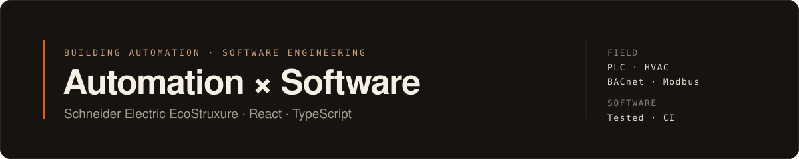
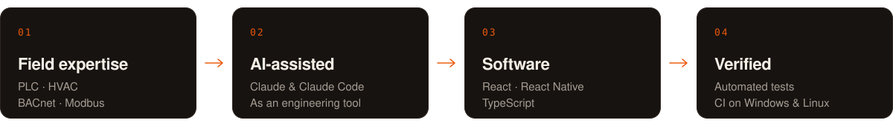

  

Building automation engineer specialised in **Schneider Electric EcoStruxure** (PLC, HVAC, BACnet and Modbus), and software developer working in **React, React Native and TypeScript**. I build reliable, tested software, grounded in field experience.

## How I work

## Expertise

<table>
  <tr>
    <td width="190"><b>Building automation</b></td>
    <td>
      
      
      
      
      
    </td>
  </tr>
  <tr>
    <td><b>Frontend</b></td>
    <td></td>
  </tr>
  <tr>
    <td><b>Mobile</b></td>
    <td>
      
      
      
    </td>
  </tr>
  <tr>
    <td><b>Backend &amp; data</b></td>
    <td>
       
      
    </td>
  </tr>
  <tr>
    <td><b>Tooling</b></td>
    <td></td>
  </tr>
  <tr>
    <td><b>AI-assisted</b></td>
    <td>
      
      
    </td>
  </tr>
</table>
